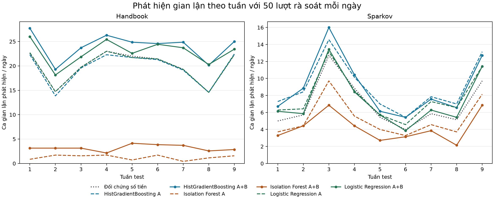

# Đánh giá 63 ngày test · Mục 5.4 (TV4)

[Bảng kết quả 14 dòng](../data/test_results_stage5.csv) điền theo mẫu đã khóa ở chặng 4. Mỗi nguồn gồm một đối chứng xếp theo số tiền và sáu cấu hình ML. Bảng có số ca phát hiện ở Top 10, 25, 50 và 100, ca đúng trung bình/ngày, Precision@50, Recall@50 và số ca bắt thêm ở hạng 51–100. [Nhật ký và bảng điểm của TV3](ml-stage-5.md)

## Kết quả trên hai nguồn

HistGradientBoosting đứng đầu ở mức Top 50 trên cả hai nguồn. Bộ A+B đứng đầu trên Handbook và bộ A đứng đầu trên Sparkov.

| Nguồn và cấu hình | Top 10 | Top 25 | Top 50 | Top 100 | Ca/ngày ở Top 50 | Precision@50 | Recall@50 | Ca thêm ở hạng 51–100 |
|---|---:|---:|---:|---:|---:|---:|---:|---:|
| Handbook · Đối chứng | 626 | 1.170 | 1.257 | 1.324 | 19,95 | 39,90% | 23,33% | 67 |
| Handbook · HistGradientBoosting A+B | 577 | 1.146 | 1.515 | 1.671 | 24,05 | 48,10% | 28,12% | 156 |
| Sparkov · Đối chứng | 144 | 321 | 437 | 550 | 6,94 | 13,87% | 56,68% | 113 |
| Sparkov · HistGradientBoosting A | 287 | 455 | 566 | 648 | 8,98 | 17,97% | 73,41% | 82 |

Ở mức Top 50, cấu hình đứng đầu phát hiện thêm 258 ca so với đối chứng trên Handbook và 129 ca trên Sparkov. Ở mức Top 10 và Top 25 trên Handbook, đối chứng và Logistic Regression A đồng hạng nhất. Trên Sparkov, HistGradientBoosting A+B đứng đầu ở mức Top 10 và Top 25, còn A đứng đầu ở mức Top 50 và Top 100.

| Thuật toán | Handbook · Chênh lệch A+B − A, ca/ngày | Sparkov · Chênh lệch A+B − A, ca/ngày |
|---|---:|---:|
| HistGradientBoosting | +4,37 | −0,05 |
| Isolation Forest | +1,92 | −1,05 |
| Logistic Regression | +2,94 | −0,38 |

Mức tăng quan sát trên Handbook không lặp lại trên Sparkov ở Top 50. HistGradientBoosting giữ `max_leaf_nodes=15` ở cả A và A+B, nên cặp này cho thấy chênh lệch khi thêm đặc trưng lịch sử với cùng tham số đã khóa. Logistic Regression đổi `C` giữa hai bộ đặc trưng trên cả hai nguồn. Isolation Forest cũng đổi `max_samples` trên Sparkov, nên các chênh lệch đó phản ánh cả đặc trưng lẫn tham số đã chọn.

## Biểu đồ theo tuần



[Dữ liệu biểu đồ theo 9 tuần](../data/test_weekly_stage5.csv) có 126 dòng. Tuần 1 bắt đầu từ ngày test đầu tiên của từng nguồn, mỗi tuần có đúng 7 ngày. Mỗi điểm trên biểu đồ bằng số ca đúng trong tuần chia cho 7.

## Đối chiếu cho TV3

Đối chiếu SHA-256 của bộ dữ liệu với cấu hình khóa và SHA-256 của từng tệp điểm với nhật ký test. Cả sáu cấu hình Handbook chấm đúng 603.785 giao dịch, cả sáu cấu hình Sparkov chấm đúng 164.600 giao dịch. Mỗi lượt đủ 63 ngày, không trùng mã, không thiếu điểm và không có NaN hay vô cực. Từng mã, ngày, thời điểm và nhãn khớp tập test chính thức của nguồn tương ứng. Tổng số điểm mô hình được kiểm tra là 4.610.310.

Để đối chiếu ngày đầu tiên, lọc dữ liệu theo ngày rồi áp dụng quy tắc xếp hạng chặng 4. Handbook ngày **30/07/2018** có 9.648 giao dịch và 90 ca gian lận. Sparkov ngày **02/05/2019** có 1.752 giao dịch và 14 ca gian lận. Mỗi dòng dưới đây rà soát đúng 50 giao dịch.

| Cấu hình | Handbook · Ca đúng | Sparkov · Ca đúng |
|---|---:|---:|
| Đối chứng theo số tiền | 26 | 9 |
| HistGradientBoosting A | 25 | 12 |
| HistGradientBoosting A+B | 27 | 12 |
| Isolation Forest A | 1 | 5 |
| Isolation Forest A+B | 4 | 6 |
| Logistic Regression A | 26 | 10 |
| Logistic Regression A+B | 26 | 10 |

Hai mã ở hạng 50 để đối chiếu ở cấu hình đứng đầu theo nguồn là `1157950` (Handbook, HistGradientBoosting A+B) và `ceaae3d848c7e94c4f10f00dcf0df123` (Sparkov, HistGradientBoosting A).

## Chạy lại

Chạy từ thư mục gốc. Script dùng dữ liệu đã khóa, mẫu 14 dòng và tệp điểm đã xuất ở mục 5.3. Cần Python 3.11+ và Matplotlib 3.7+ để vẽ biểu đồ. Kết quả dùng trực tiếp quy tắc xếp hạng và công thức ở [chặng 4](evaluation-stage-4.md).

```powershell
$stage5Check = Join-Path $env:TEMP "tv4-stage5-check"
python scripts/evaluate_test_stage5.py --output-dir $stage5Check
```

Hai CSV và hình PNG được ghi vào thư mục đầu ra. Terminal in số cảnh báo và số ca đúng của ngày test đầu tiên theo từng cấu hình để TV3 đối chiếu.
